# 06: Mapping patterns

The SMK-37 has more controls than the FM-1: ten more keys, 16 RGB pads, 4 faders, 2 wheels and 4 more
buttons. These patterns put them to work. Each one ran on a real unit in at least one port. Pick per control
group, write the choice into [`smk37-port.yaml`](../smk37-port.yaml), then implement it.

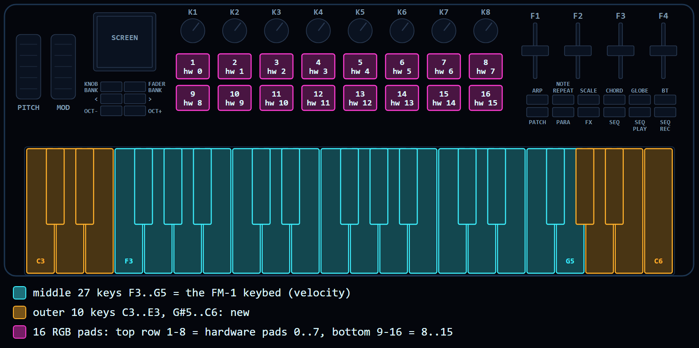

Pad numbers in this guide are in reading order: pads 1-8 are the top row (hardware pads 0..7), pads 9-16 the
bottom row (hardware pads 8..15). The hardware index is the same for hits and LEDs; see
[01-hardware.md](01-hardware.md), 6.3. The diagrams are drawn by `tools/make_panels.py`.

**The base rules:**

1. **The firmware's own layout first.** Every FM-1 control keeps a home on the SMK, in the firmware's own order
   and grouping and under its own names, so its manual still applies. The extra controls add to that and never
   take something away. A new firmware (no FM-1 manual to keep) can drop this rule.
2. **No doubles.** A control never repeats another control's job, unless the owner asks for it. Before giving a
   new control a job, ask what has no direct control yet.

## Quick chooser

| Control | Pattern | Used in | Choose it when |
|---|---|---|---|
| Keys | [Middle 27 = FM-1 keys](#keys-the-fm-1-range-in-the-middle) | all ports | always |
| Outer keys | [Extend, drums on a drum track](#outer-keys-extend-and-drums) | Snoop37 | the firmware has a drum track or a range limit |
| Pads | [Steps in reading order](#pads-steps-in-reading-order) | Snoop37, X0X37, Felucca PR | the firmware has a 16-step sequencer |
| Pads | [Sound picker](#pads-sound-picker) | Snoop37 | many presets, chosen by scrolling on the FM-1 |
| Pads | [Voices and a CHAOS pad](#pads-voices-and-a-big-gesture) | Makkuro37 | a drone or multi-voice instrument |
| Pads | [Strum plate](#pads-strum-plate) | FoMni37 | a chord instrument |
| Faders | [Banks with soft takeover](#faders-banks-with-soft-takeover) | Snoop37, Makkuro37, FoMni37 | per-track settings, more than four jobs |
| Faders | [What has no direct control](#faders-what-has-no-direct-control) | | the knobs already reach every parameter on screen |
| Wheels | [Bend and vibrato, or a macro](#wheels-bend-and-vibrato-or-a-macro) | all ports | always |
| Knobs | [The FM-1 top row](#knobs-the-fm-1-top-row) | Snoop37, X0X37, FoMni37 | keeping the FM-1 workflow |
| Knobs | [A page per button, eight columns](#knobs-a-page-per-button-eight-columns) | Makkuro37 | a redesign with many parameters per voice |
| Buttons | [Printed meaning, four extras](#buttons-printed-meaning-and-four-extras) | Snoop37, X0X37, FoMni37 | the firmware names its buttons by function |
| Buttons | [By row](#buttons-by-row) | | the firmware groups its buttons by row (one row of verbs, one of modes) |
| Whole port | [A toy for children](#a-toy-for-children) | RAINBOW37 | a firmware for kids, or any safe-by-default instrument |

## Keys: the FM-1 range in the middle

The middle 27 keys (keybed 5..31, F3..G5) are the FM-1's note keys, with velocity from the unit's own factory
curves (the `trimdat` record, read only). In layers where the FM-1 uses its keys as tiles (steps, effects, mix),
the same keys do the same thing. Used by every port.

## Outer keys: extend and drums

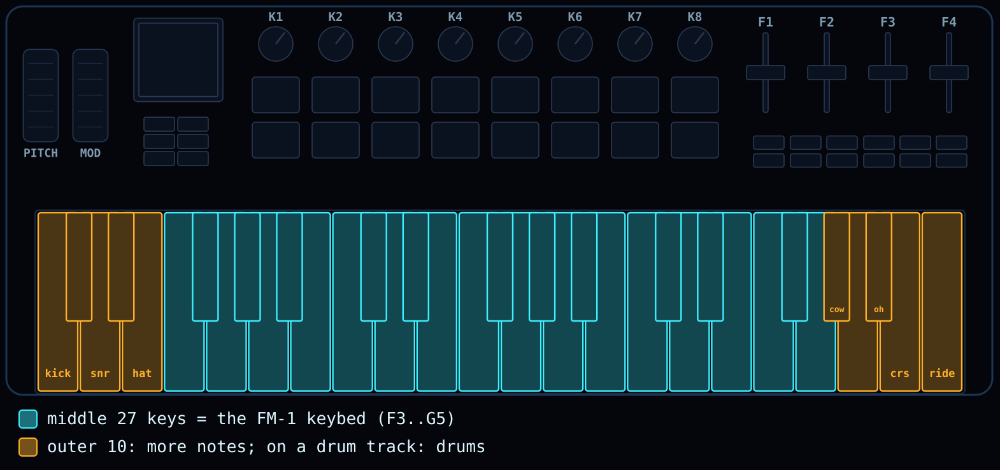

The 10 outer keys (C3-E3, G#5-C6) extend the keyboard by default: on a synth track they play notes. On a drum
track they play drums, so you can finger-drum while the middle keys keep their FM-1 job. A black key plays its left
white neighbour.

- **Snoop37:** C3 kick, D3 snare, E3 hi-hat; G#5 cowbell, A5 open hi-hat, B5 crash, C6 ride.
- **Choose:** extend when the firmware plays notes; drums when it has a drum track; transpose or off when the
  middle keys are tiles most of the time.
- **Watch:** an outer-key drum hit lights no pad (the pads show steps).

## Pads: steps in reading order

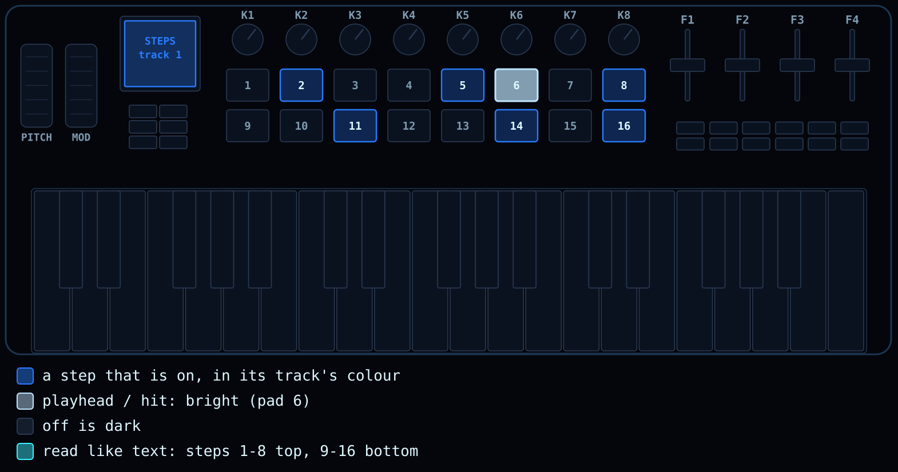

The 16 pads are the FM-1's 16 white keys F3..G5, in **reading order**: steps 1-8 on the top row, 9-16 on the
bottom (hardware pads 0..7 and 8..15). Convert in one place, for hits and LEDs alike. Pads light in the
screen's track colours: steps that are on are lit, the playhead and hits bright, off is dark (no glow layers).
Pads play with velocity.

- **Used in:** Snoop37 (also a piano layout in the SEL layer, save slots in the SAVE layer), X0X37 (the step
  grid), the Felucca PR.
- **Choose:** the firmware sequences 16 steps, or its white keys are tiles. This is the default.

## Pads: sound picker

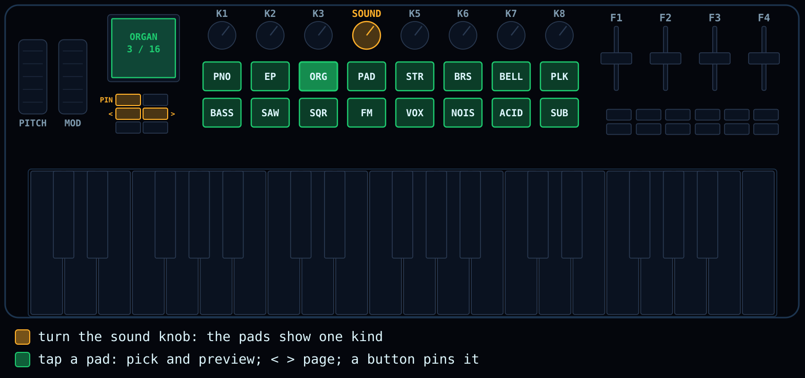

Turning the sound knob (K4, PRESETS) shows the sounds of one kind on the pads and the screen. A pad picks and
previews, `<` `>` page through the kinds, and a button (KNOB BANK) pins the picker open. After a knob turn it stays
for a short time, then the pads go back to steps.

- **Used in:** Snoop37.
- **Choose:** the firmware has many presets that the FM-1 can only scroll through.

## Pads: voices and a big gesture

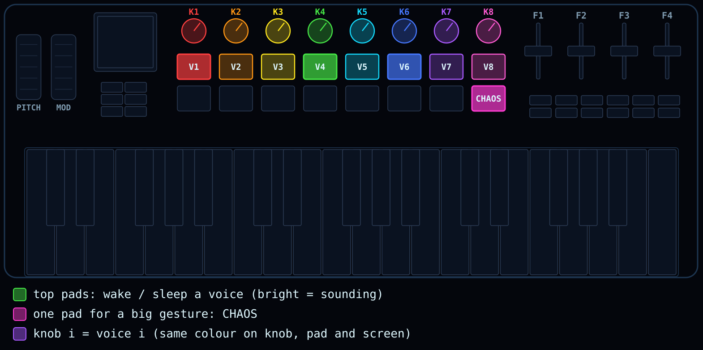

The pads gate voices: the top row wakes and sleeps voice 1..8, the voice's colour on the pad, its knob and the
screen. One pad does a big gesture (CHAOS) that is hard to do with knobs.

- **Used in:** Makkuro37 (eight drone voices).
- **Choose:** a drone, a multi-voice or a live-performance instrument without a step sequencer.

## Pads: strum plate

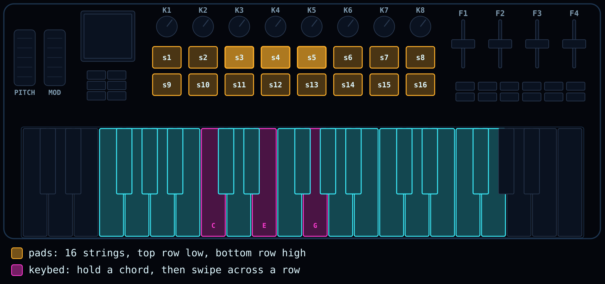

The pads are 16 strings: top row low, bottom row high. The keybed holds the chord; a finger across a row strums
it. A string lights while it rings; at rest the root strings glow dimly. Velocity sets loudness and brightness.

- **Used in:** FoMni37 (the Omnichord-style chord harp).
- **Choose:** a chord instrument, an arpeggiator or anything played by sweeping.

## Faders: banks with soft takeover

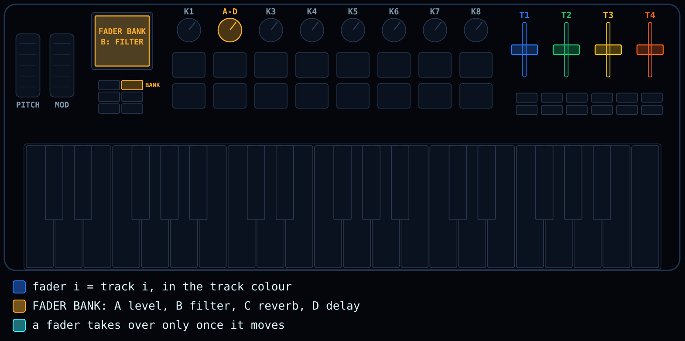

Fader i sets track i, in the track's colour. FADER BANK picks what they set: **A** level, **B** filter
(low-pass left, open centre, high-pass right), **C** reverb send, **D** delay send. A fader takes over only once it
moves, also after a bank change, so nothing jumps. A FADER BANK screen shows all four banks; its LED is lit off
bank A.

- **Used in:** Snoop37 (as above), Makkuro37 (banks FX L, FX R, LFO, PLAY, OUTPUT), FoMni37 (banks A and B).
- **Choose:** per-track settings, or more than four things worth a fader.

## Faders: what has no direct control

When banks or a mixer would repeat what the knobs already do, give the faders the amounts that have no control of
their own: a standing effect level that otherwise sits in a menu, a send, a balance between two engines. List the
firmware's parameters, cross out what a knob or button already reaches, and offer the owner the rest.

- **Choose:** the owner's rule is "no doubles" and the knobs cover the screen's parameters.

## Wheels: bend and vibrato, or a macro

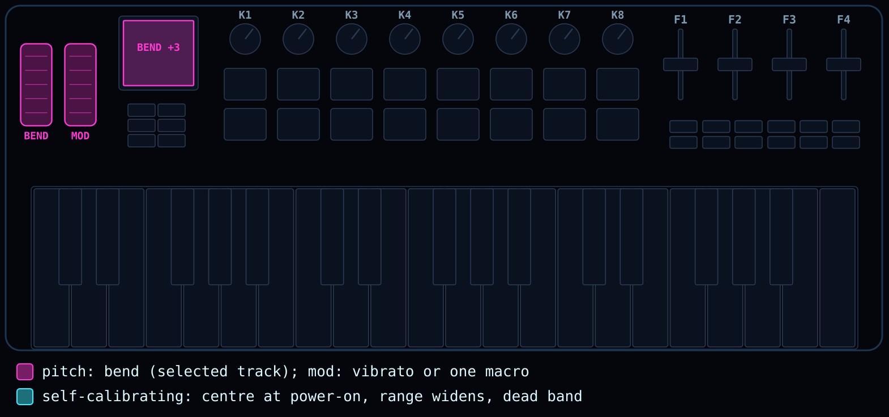

Pitch wheel = bend (Snoop37: +-7 semitones on the selected track; FoMni37: +-2). Mod wheel = vibrato (Snoop37:
10 Hz, up to +-1 semitone, up = more; FoMni37: 5.5 Hz, up to +-1/2 semitone), or one performance macro. The
wheels calibrate themselves: centre taken at power-on, the range widens as the wheel is seen to move, with a dead
band around the centre.

- **Choose:** bend and vibrato unless the instrument has one gesture worth a wheel.

## Knobs: the FM-1 top row

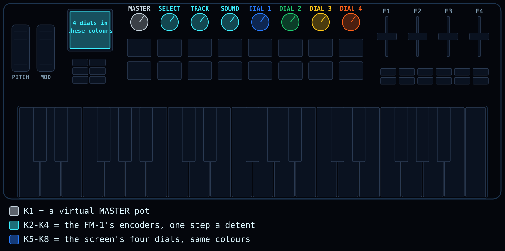

K1-K8 are the FM-1's knobs: K1 is a virtual MASTER pot (the FM-1's pot is absolute; K1 is an encoder, so it
steps a stored value, 24 of 1024 per detent in Snoop37), K2-K4 the encoders, K5-K8 the screen's four dials in
their colours. One encoder step per detent. Keep the order the firmware's screen uses: SLOOP shows SELECT,
ALGORITHM, PRESETS (K2, K3, K4); a firmware that shows SELECT, PRESETS, ALGORITHM keeps that order.

- **Used in:** Snoop37, X0X37, FoMni37.
- **Choose:** keeping the FM-1 workflow. Matching knob caps make it obvious.

## Knobs: a page per button, eight columns

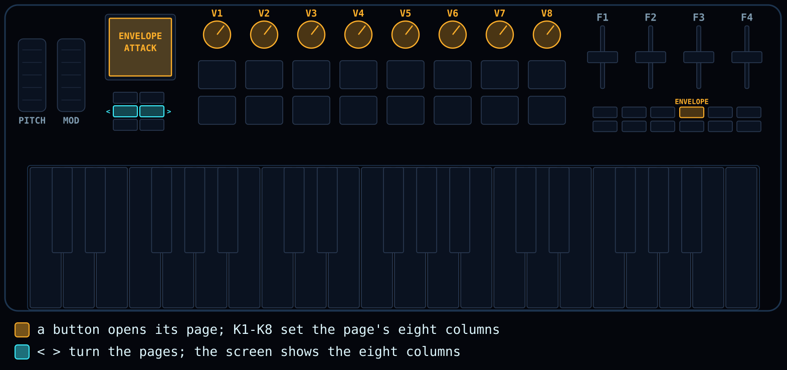

One logic for every menu: a button opens its page, K1-K8 set the page's eight columns (one per voice, or eight
parameters), `<` `>` turn the pages. A value with two choices can sit on the column's pads. The screen draws the
eight columns in the knobs' order, so knob i always means column i.

- **Used in:** Makkuro37.
- **Choose:** a redesign with many parameters per voice; one rule replaces many menus.

## Buttons: printed meaning and four extras

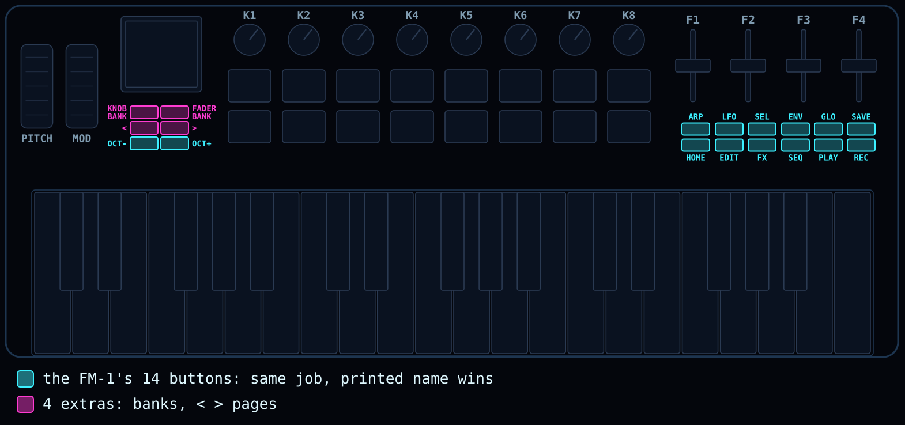

The FM-1's 14 buttons keep their jobs on the SMK button that means the same: PATCH = HOME, CHORD = ENV,
NOTE REPEAT = LFO, SCALE = SEL, PARA = EDIT, GLOBE = GLO, BT = SAVE, SEQ PLAY = PLAY, SEQ REC = REC, OCTAVE-/+ =
OCT-/+. The four extras: KNOB BANK and FADER BANK for banks or pins, `<` `>` for pages (never tempo). Full table:
[04-controls-mapping.md](04-controls-mapping.md). Use the firmware's own button names in its docs (SLOOP calls
SEL what Felucca calls SCL).

## Buttons: by row

The FM-1 has two rows of six buttons; the SMK's grid is two rows of six too. When a firmware groups by row (for
example one row of actions, one of modes), keep its rows: FM-1 top row to SMK top row, bottom to bottom, left to
right. The printed names then no longer match, so the screen and the controls table say what each button does.

- **Choose:** the firmware's manual explains its buttons by row rather than by name.

## A toy for children

A firmware a child plays alone. Used in RAINBOW37 (Rainbow mode, with the full Felucca behind a combo).

- **Volume cap.** The grown-ups set a cap; K1 never goes above it. K1 is a virtual pot, so clamp the pot value
  (`smk_master`) as well as the level, or turning down does nothing for many detents.
- **Fixed velocity.** The layer reads velocity in `key_vel` and in the outer-key queue. Put one switch there
  (RAINBOW37: `SMK_KEY_VELOCITY 0` = every key and pad at 100) instead of editing each place.
- **No menu from the toy.** No stray press opens a menu (not KNOB BANK either). The grown-up controls (a held
  button, a long combo) are hidden on purpose: the owner's exception to "no hidden modes", noted in the setup file.
- **Two UIs.** The toy and the full firmware each get their own mapping (`modes:` in the setup file).
- **Teaching with lights.** The SMK has no key LEDs. Pads as white keys can light the next white key; black keys
  have no pad. Options: the piano layout on the pads (black keys in the top row), or a keyboard strip on the screen.

## Screen and UX rules

These are the owner's rules from the ports so far. Keep them unless the owner says otherwise.

1. **Group by meaning.** Screens are laid out by function, the knob block at the bottom of the screen, not in
   the hardware's order.
2. **Touch, then see.** The screen shows what you touch first: the value next to the thing it changes, and a
   short hint line saying what the control does.
3. **Same colour, same place.** A colour means the same thing on the screen, the pads and the knob caps; the
   screen's layout follows the panel's. A firmware whose screen maps the FM-1's panel (for example its knobs as a
   2x2 block) gets a map of the SMK's panel instead: eight knobs in one row, in the same order.
4. **No hidden modes.** Every state is visible (an LED, a header, a colour). A held button only lends something
   while it is held.
5. **Play first.** Sound on power-on, few menus, nothing that needs the manual to make a noise.
